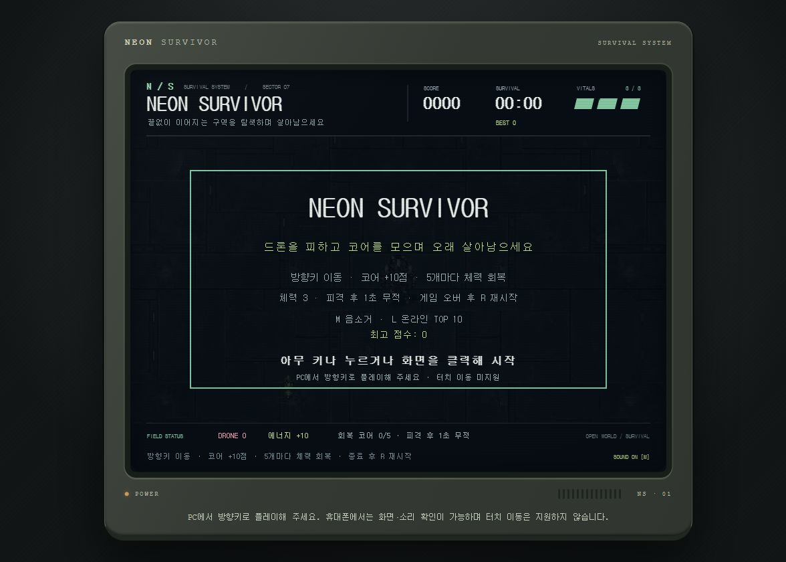

# NEON SURVIVOR

[게임 플레이](https://hwageu.github.io/my-game/) · [GitHub 저장소](https://github.com/Hwageu/my-game)

넓은 네온 공간에서 드론을 피하고 에너지 코어를 모으는 2D 생존 게임입니다. 간단한 조작으로 오래 버티며 기록에 도전할 수 있을 것 같아 이 게임을 골랐습니다.

- 학번 / 이름: 202370036 / 서준영

## 조작법

| 입력 | 동작 |
|---|---|
| 시작 화면에서 키 또는 클릭 | 게임 시작 |
| 방향키 | 상하좌우·대각선 이동 |
| R | 게임 오버 후 재시작 |
| M | 음소거 전환 |
| D | 디버그 정보와 판정 영역 전환 |
| L | 시작·게임 오버 화면에서 온라인 TOP 10 |
| N | 게임 오버 후 닉네임으로 기록 등록 |

M·L은 시작 대신 해당 기능을 실행합니다. 디버그는 기본으로 꺼져 있습니다.

## 규칙

- 체력 3, 코어 1개당 10점, 5개마다 체력 1 회복(최대 3).
- 충돌 시 체력 1 감소와 1초 무적, 체력 0이면 종료.
- 무한 맵과 카메라를 사용하며 800×600은 표시 범위입니다.
- 드론은 4대부터 10초마다 1대 추가, 최대 12대.
- 20초마다 초기 속도의 10% 증가, 최대 1.8배.
- HUNTER 한 대는 12초 후 진입해 추적합니다. 최고 속도 1.71로 플레이어 속도 2보다 느립니다.
- R키로 점수·체력·위치·시간·난이도·적·코어를 초기화합니다. 최고 점수와 음소거는 유지합니다.
- 코어는 구역별 랜덤 배치이며 최대 128구역을 보관합니다. 정리된 구역에 다시 오면 위치가 바뀔 수 있습니다.
- 게임 오버 문구는 messages.json에서 고르며 실패하면 기본 문구를 씁니다.

## 모바일

PC에서 방향키로 플레이해 주세요. 휴대폰에서는 화면·시작·소리를 확인할 수 있지만 터치 이동은 지원하지 않습니다. 화면 크기만 줄이며 Canvas 좌표 크기는 유지합니다.

## 온라인 랭킹

Supabase REST API로 닉네임과 점수를 등록하고 상위 10개를 표시합니다. N키를 눌렀을 때만 등록하며 한 판의 중복 제출을 막습니다. 닉네임은 1~8자, 점수는 정수 0~100만입니다. 실명·학번·연락처를 입력하지 마세요.

RLS와 SQL 권한으로 읽기·등록만 허용하고 수정·삭제를 차단합니다. 등록 시각은 서버가 기록합니다. 코드의 sb_publishable_ 키는 공개용이며 비밀 키·DB 비밀번호는 넣지 않았습니다. 서버 실패 시에도 게임과 로컬 최고 점수는 동작합니다. 브라우저가 보내는 점수를 완전히 검증할 수는 없습니다. 검증용 0점은 서버 테스트 기록이며 사람의 플레이 점수가 아닙니다.

[보안점검.md](보안점검.md)에 실제 검증 결과를 기록했습니다.

## 개발 환경과 실행

Windows, VS Code, Live Server, Git·GitHub, GitHub Pages를 사용합니다. 폴더를 VS Code에서 열고 index.html을 Live Server로 실행합니다. 본 게임은 순수 HTML/CSS/JS 3파일이며 외부 게임 라이브러리나 빌드 도구를 쓰지 않습니다. 파일 직접 열기에서는 JSON 대신 기본 문구를 사용합니다. 네트워크가 끊겨도 이미 불러온 게임은 계속됩니다.

## 사용한 에셋과 AI 도구

코드·디버깅·문서에는 OpenAI Codex/ChatGPT를 사용했습니다. 그림은 OpenAI 이미지 생성 도구로 제작했고, 효과음은 외부 샘플 없이 파형을 직접 합성했습니다.

| 파일 | 용도 | 출처 | 라이선스·사용 조건 |
|---|---|---|---|
| assets/floor-tile.jpg | 반복 바닥 | 프로젝트용 AI 생성(OpenAI 이미지 생성 도구) | 외부 원본 없음·별도 공개 라이선스 미지정 |
| assets/survivor-directions.png | 방향별 대기 | 프로젝트용 AI 생성(OpenAI 이미지 생성 도구) | 외부 원본 없음·별도 공개 라이선스 미지정 |
| assets/survivor-walk.png | 상하 보행 | 프로젝트용 AI 생성(OpenAI 이미지 생성 도구) | 외부 원본 없음·별도 공개 라이선스 미지정 |
| assets/survivor-sidewalk.png | 좌우 보행 | 프로젝트용 AI 생성(OpenAI 이미지 생성 도구) | 외부 원본 없음·별도 공개 라이선스 미지정 |
| assets/drone-directions.png | 드론 모션 | 프로젝트용 AI 생성(OpenAI 이미지 생성 도구) | 외부 원본 없음·별도 공개 라이선스 미지정 |
| assets/energy-core.png | 코어 첫 프레임 | 프로젝트용 AI 생성(OpenAI 이미지 생성 도구) | 외부 원본 없음·별도 공개 라이선스 미지정 |
| assets/survivor.png | 초기 생존자 참조 | 프로젝트용 AI 생성(OpenAI 이미지 생성 도구) | 외부 원본 없음·별도 공개 라이선스 미지정 |
| assets/drone.png | 초기 드론 참조 | 프로젝트용 AI 생성(OpenAI 이미지 생성 도구) | 외부 원본 없음·별도 공개 라이선스 미지정 |
| assets/point.wav | 코어 효과음 | 직접 합성 | 외부 원음 없음·별도 라이선스 미지정 |
| assets/hit.wav | 피격 효과음 | 직접 합성 | 외부 원음 없음·별도 라이선스 미지정 |
| assets/gameover.wav | 종료 효과음 | 직접 합성 | 외부 원음 없음·별도 라이선스 미지정 |
| messages.json | 점수별 응원 | ChatGPT로 사전 작성 | 외부 원문 없음·별도 라이선스 미지정 |
| assets/screenshot.png | 게임 화면 | 실행 화면 직접 캡처 | 본 프로젝트 화면 |
| Phaser 3.86.0 | 별도 비교 예제만 | [공식 프로젝트](https://github.com/phaserjs/phaser)·cdnjs CDN | MIT, 본 게임에는 미사용 |

## 제작 과정

| 단계 | 결과 |
|---|---|
| 1~2장 | 자기소개·게임 아이디어·Git·배포 |
| 3~5장 | 기획·Canvas·게임 루프·입력·무한 맵 |
| 6~8장 | 규칙·피격 반응·시작 화면·소리·최고 점수 |
| 9장 | 피격 HUD·draw 분리·모바일 안내·검증 목록 |
| 10장 | README·전체 회고·3분 발표 원고 |
| 11장 | 온라인 랭킹·RLS·값 제한·실패 처리 |
| 12장 | 응원 문구·추적 적·비교와 학습 예제 |

[회고](회고.md) · [플레이테스트](플레이테스트.md) · [테스트 목록](테스트목록.md) · [디버깅 기록](디버깅기록.md) · [발표 원고](발표.md) · [도구 비교](비교.md) · [AI 설계](ai설계.md)

[숨은 버그 연습](debug-practice.html) · [API 연습](api-test.html) · [Phaser 비교](phaser-test.html) · [입자 효과](learn-test.html)

## 검증 결과

공개 배포에서 시작·게임 오버·응원 문구·R 재시작과 N키 등록을 확인했습니다. 시작·플레이·게임 오버 콘솔 오류/경고는 없었습니다. 320·390·768·1440px에서 가로 넘침이 없었고, 랭킹의 서버 권한과 값 제한을 실제 검증했습니다. 세부 범위는 테스트목록.md에 있습니다.

## 앞으로 하고 싶은 것과 남은 직접 확인

- [ ] 실제 테스터 2명 이상(처음 보는 사람 포함)의 관찰과 세 질문 답변 수집
- [ ] 다른 사람·휴대폰에서 온라인 랭킹 등록 확인
- [x] 별도 예제 중력 450→600·입자 수 12→30 변경 실행 확인
- [ ] 시크릿 모드 전체 플레이와 실제 3분 발표

터치 이동과 인증·점수 검증 강화는 후속 개선으로 남깁니다. 가상 예시는 실제 사람의 테스트와 구분하고, 발표 원고 작성과 실제 발표도 구분합니다.
