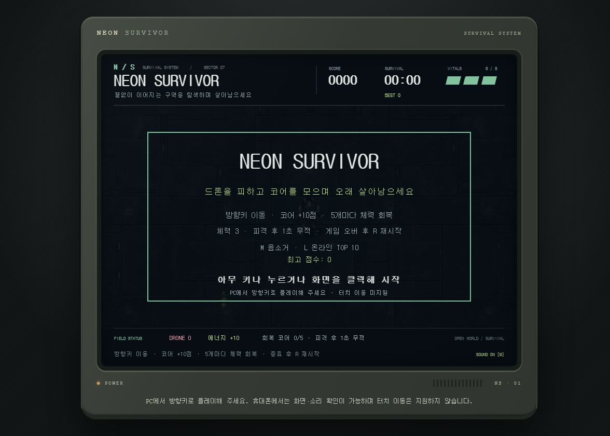

# NEON SURVIVOR

[게임 플레이](https://hwageu.github.io/my-game/) · [GitHub 저장소](https://github.com/Hwageu/my-game)

넓은 네온 공간에서 드론을 피하고 에너지 코어를 모으는 2D 생존 게임입니다. 간단한 조작으로 오래 버티며 기록에 도전할 수 있을 것 같아 이 게임을 골랐습니다.

- 학번 / 이름: 202370036 / 서준영

## 조작법

| 입력 | 동작 |
|---|---|
| 시작 화면에서 키 또는 클릭 | 게임 시작 |
| 방향키 | 상하좌우·대각선 이동 |
| R | 게임 오버 후 재시작 |
| M | 배경음악·효과음 전체 음소거 전환 |
| D | 디버그 정보와 판정 영역 전환 |
| L | 시작·게임 오버 화면에서 온라인 TOP 10 |
| N | 게임 오버 후 닉네임으로 기록 등록 |

M·L은 시작 대신 해당 기능을 실행합니다. 디버그는 기본으로 꺼져 있습니다.

## 규칙

- 플레이 중에는 20초 길이의 레트로 신스 음악을 음량 0.65로 반복합니다. 시작 전에는 재생하지 않고, 게임 오버 때 정지합니다. M키로 음악과 효과음을 함께 끕니다.

- 체력 3, 코어 1개당 10점, 5개마다 체력 1 회복(최대 3).
- 충돌 시 체력 1 감소와 1초 무적, 체력 0이면 종료.
- 무한 맵과 카메라를 사용하며 800×600은 표시 범위입니다.
- 드론은 4대부터 10초마다 1대 추가, 최대 12대.
- 20초마다 초기 속도의 10% 증가, 최대 1.8배.
- HUNTER 한 대는 12초 후 진입해 추적합니다. 최고 속도 1.71로 플레이어 속도 2보다 느립니다.
- R키로 점수·체력·위치·시간·난이도·적·코어를 초기화합니다. 최고 점수와 음소거는 유지합니다.
- 코어는 구역별 랜덤 배치이며 최대 128구역을 보관합니다. 정리된 구역에 다시 오면 위치가 바뀔 수 있습니다.
- 게임 오버 문구는 messages.json에서 고르며 실패하면 기본 문구를 씁니다.

## 모바일

휴대폰에서는 게임 실행 시 화면 안에 전용 터치 조작을 표시합니다. 네온 서바이벌은 왼쪽 패드로 이동하고 오른쪽 버튼으로 일시정지·재시작·TOP 10 조회·게임 오버 후 기록 등록을 합니다. 세로 화면에는 점수·체력·시간을 별도로 크게 표시합니다. 4:3 게임 화면은 비율을 유지합니다. FPS는 화면 비율에 맞춰 시야를 표시하며 왼쪽 패드로 이동, 화면 드래그로 조준, FIRE 버튼으로 사격합니다. 장전·작동·무기 전환·일시정지 버튼을 따로 제공합니다. 가로 화면에서는 더 넓게 볼 수 있습니다. PC에서도 터치 조작 버튼으로 켤 수 있습니다.

## 온라인 랭킹

Supabase REST API로 닉네임과 점수를 등록하고 상위 10개를 표시합니다. N키를 눌렀을 때만 등록하며 한 판의 중복 제출을 막습니다. 닉네임은 1~8자, 점수는 정수 0~100만입니다. 실명·학번·연락처를 입력하지 마세요.

RLS와 SQL 권한으로 읽기·등록만 허용하고 수정·삭제를 차단합니다. 등록 시각은 서버가 기록합니다. 코드의 sb_publishable_ 키는 공개용이며 비밀 키·DB 비밀번호는 넣지 않았습니다. 서버 실패 시에도 게임과 로컬 최고 점수는 동작합니다. 브라우저가 보내는 점수를 완전히 검증할 수는 없습니다. 검증용 0점은 서버 테스트 기록이며 사람의 플레이 점수가 아닙니다.

[보안점검.md](보안점검.md)에 실제 검증 결과를 기록했습니다.

## 개발 환경과 실행

Windows, VS Code, Live Server, Git·GitHub, GitHub Pages를 사용합니다. 폴더를 VS Code에서 열고 index.html을 Live Server로 실행합니다. 본 게임은 순수 HTML/CSS/JS 3파일이며 외부 게임 라이브러리나 빌드 도구를 쓰지 않습니다. 파일 직접 열기에서는 JSON 대신 기본 문구를 사용합니다. 네트워크가 끊겨도 이미 불러온 게임은 계속됩니다.

## 사용한 에셋과 AI 도구

코드·디버깅·문서에는 OpenAI Codex/ChatGPT를 사용했습니다. 그림은 OpenAI 이미지 생성 도구로 제작했고, 효과음은 외부 샘플 없이 파형을 직접 합성했습니다.

| 파일 | 용도 | 출처 | 라이선스·사용 조건 |
|---|---|---|---|
| assets/floor-tile.jpg | 반복 바닥 | 프로젝트용 AI 생성(OpenAI 이미지 생성 도구) | 외부 원본 없음·별도 공개 라이선스 미지정 |
| assets/survivor-directions.png | 방향별 대기 | 프로젝트용 AI 생성(OpenAI 이미지 생성 도구) | 외부 원본 없음·별도 공개 라이선스 미지정 |
| assets/survivor-walk.png | 상하 보행 | 프로젝트용 AI 생성(OpenAI 이미지 생성 도구) | 외부 원본 없음·별도 공개 라이선스 미지정 |
| assets/survivor-sidewalk.png | 좌우 보행 | 프로젝트용 AI 생성(OpenAI 이미지 생성 도구) | 외부 원본 없음·별도 공개 라이선스 미지정 |
| assets/drone-directions.png | 드론 모션 | 프로젝트용 AI 생성(OpenAI 이미지 생성 도구) | 외부 원본 없음·별도 공개 라이선스 미지정 |
| assets/energy-core.png | 코어 첫 프레임 | 프로젝트용 AI 생성(OpenAI 이미지 생성 도구) | 외부 원본 없음·별도 공개 라이선스 미지정 |
| assets/point.wav | 코어 효과음 | 직접 합성 | 외부 원음 없음·별도 라이선스 미지정 |
| assets/hit.wav | 피격 효과음 | 직접 합성 | 외부 원음 없음·별도 라이선스 미지정 |
| assets/gameover.wav | 종료 효과음 | 직접 합성 | 외부 원음 없음·별도 라이선스 미지정 |
| assets/ambience.wav | 20초 레트로 신스 BGM | 프로젝트용 직접 작곡·합성 | 외부 음원 없음·별도 라이선스 미지정 |
| messages.json | 점수별 응원 | ChatGPT로 사전 작성 | 외부 원문 없음·별도 라이선스 미지정 |
| screenshot.png | 게임 화면 | 실행 화면 직접 캡처 | 본 프로젝트 화면 |
| Phaser 3.86.0 | 별도 비교 예제만 | [공식 프로젝트](https://github.com/phaserjs/phaser)·cdnjs CDN | MIT, 본 게임에는 미사용 |

## 파일 구성

- 실행: index.html·style.css·script.js·messages.json, screenshot.png, assets/
- 본과정 문서: README.md·기획서.md·회고.md·디버깅기록.md·플레이테스트.md·테스트목록.md·발표.md
- 필수 실습: debug-practice.html(7장), phaser-test.html·learn-test.html(12장)
- 심화 자료: ranking-schema.sql·보안점검.md·비교.md·ai설계.md

실습 파일은 게임 본체와 별개이며 워크북 제출물이라 유지합니다. 미사용 초기 이미지 2개와 선택 API 연습 파일은 외부 백업 후 정리했습니다. 1주차 자기소개 원본은 상위 week01 폴더에 보존되어 있습니다.

## 제작 과정

| 단계 | 결과 |
|---|---|
| 1~2장 | 자기소개·게임 아이디어·Git·배포 |
| 3~5장 | 기획·Canvas·게임 루프·입력·무한 맵 |
| 6~8장 | 규칙·피격 반응·시작 화면·소리·최고 점수 |
| 9장 | 피격 HUD·draw 분리·모바일 안내·검증 목록 |
| 10장 | README·전체 회고·3분 발표 원고 |
| 11장 | 온라인 랭킹·RLS·값 제한·실패 처리 |
| 12장 | 응원 문구·추적 적·비교와 학습 예제 |

[회고](회고.md) · [플레이테스트](플레이테스트.md) · [테스트 목록](테스트목록.md) · [디버깅 기록](디버깅기록.md) · [발표 원고](발표.md) · [도구 비교](비교.md) · [AI 설계](ai설계.md)

[숨은 버그 연습](debug-practice.html) · [Phaser 비교](phaser-test.html) · [입자 효과](learn-test.html)

## 검증 결과

공개 배포에서 시작·게임 오버·응원 문구·R 재시작과 N키 등록을 확인했습니다. 시작·플레이·게임 오버 콘솔 오류/경고는 없었습니다. 320·390·768·1440px에서 가로 넘침이 없었고, 랭킹의 서버 권한과 값 제한을 실제 검증했습니다. 세부 범위는 테스트목록.md에 있습니다.

## 앞으로 하고 싶은 것과 남은 직접 확인

- [ ] 실제 테스터 2명 이상(처음 보는 사람 포함)의 관찰과 세 질문 답변 수집
- [ ] 다른 사람·휴대폰에서 온라인 랭킹 등록 확인
- [x] 별도 예제 중력 450→600·입자 수 12→30 변경 실행 확인
- [ ] 시크릿 모드 전체 플레이와 실제 3분 발표

인증·점수 검증 강화는 후속 개선으로 남깁니다. 실제 사람의 테스트 기록만 유지하며, 발표 원고 작성과 실제 발표는 구분합니다.

### 게임 선택과 일시정지

오락기 형태의 NEON ARCADE 메뉴에서 NEON SURVIVOR와 VOID BREACH를 선택합니다. CYBER ESCAPE는 준비 중입니다. 두 게임의 썸네일은 실제 실행 화면입니다. 메뉴에서는 직접 합성한 8비트 음악을 재생하며 음악 버튼으로 끌 수 있습니다. COIN 버튼을 누르면 동전 투입 효과음이 납니다. 게임 중 P 또는 ESC, 화면 아래 일시정지 버튼으로 멈출 수 있습니다. 재개하면 3·2·1 뒤 이어집니다. 멈춘 시간과 카운트다운은 생존 시간·난이도·무적 시간에서 제외하며 배경음악도 멈춥니다. 탭이나 창을 벗어나면 자동으로 일시정지합니다. 게임 선택 메뉴로 돌아갔다가 현재 판을 이어갈 수도 있습니다.

메뉴에서는 ↑·↓로 선택하고 Enter·Space 또는 조작대 START 버튼으로 실행합니다. 조이스틱 위·아래 버튼이나 게임 이름 클릭으로도 선택할 수 있습니다. 준비 중인 게임을 선택해 실행하면 안내 문구를 표시합니다. 캐비닛 구조는 첨부된 오락기 사진과 [Neo Geo MVS 자료](https://www.arcade-museum.com/Videogame/neo-geo-mvs)를 참고했으며, 외부 로고·게임 그림은 사용하지 않았습니다.

메뉴와 플레이 화면은 동일한 캐비닛·CRT 테두리를 공유합니다. START 버튼은 플레이 중 일시정지, 멈춘 상태에서는 3초 뒤 재개, 게임 오버에서는 재시작으로 동작합니다. BGM 기본 음량은 0.65이며 M키로 효과음과 함께 음소거합니다.

조작대 조이스틱은 위에서 본 원형 받침대와 손잡이로 표현하며 금속 축은 표시하지 않습니다. 방향키 입력에 따라 손잡이가 해당 방향으로 움직입니다. 대각선을 지원하며 키 해제·창 이탈·일시정지 시 중앙으로 돌아옵니다. 받침대는 고정되어 있습니다.

## VOID BREACH — 메뉴 2번

Three.js 기반의 3개 스테이지로 이어지는 독립적인 3D FPS입니다. 각 구역의 장치 3개를 E키로 작동하고 북동쪽 탈출구에 도달합니다. 마지막 구역에서는 중앙 수호기도 제압해야 합니다. WASD 이동, Shift 달리기, Space 돌진, 마우스 조준·좌클릭 사격, R 장전, 1/2/3 무기 전환, Esc 일시정지입니다. 미니맵과 다음 목표의 방향·거리를 표시합니다. 마우스 잠금을 사용할 수 없는 환경은 시작 화면의 대체 모드에서 우클릭 드래그로 시점을 조작합니다.

게임 코드는 fps/에 분리했습니다. vendor/에는 Three.js 0.180.0과 MIT 라이선스를 보관합니다. 시설·무기·로봇 모델과 표면 무늬 및 효과음은 코드로 제작했습니다. 구역별 조명·벽면 배관과 골조, 금속 패널, 관절형 로봇과 권총·쌍열 산탄총·소총의 독립적인 모델을 사용합니다. 기존 네온 서바이벌에도 비율을 유지하는 전체화면 버튼을 제공합니다.

### FPS 전투와 소리

빨간 칼날을 든 근접 적은 팔을 들어 공격을 예고합니다. 긴 소총을 든 파란 총병과 넓은 장갑·4연장 포신을 가진 황토색 중화기 적은 충전 빛과 조준선을 보인 뒤 탄환을 발사합니다. 옆으로 피하거나 벽 뒤로 숨으면 탄환을 피할 수 있습니다. 피격 시 화면의 붉은 효과·흔들림·소리와 체력 감소로 알립니다. 별도 피격 문구는 표시하지 않습니다. R키 또는 장전 버튼으로 재장전하며 진행 막대와 무기 동작으로 상태를 확인합니다.

FPS 배경음악은 168 BPM의 팜뮤트 파워 코드·베이스·더블킥·스네어로 구성한 독자적인 메탈 루프입니다. 플레이 중에만 반복하며 일시정지·게임 종료 시 멈춥니다. 메뉴 음악과 FPS 음악은 외부 샘플 없이 프로젝트용으로 직접 합성했습니다. 브라우저 정책에 따라 첫 클릭·터치 이후 소리가 시작됩니다.

| 추가 파일 | 용도·출처 |
|---|---|
| assets/menu-chip.wav | 직접 합성한 16초 메뉴 8비트 BGM |
| fps/industrial.wav | 직접 합성한 약 23초 FPS 메탈 BGM |
| assets/neon-preview.png | 네온 서바이벌 실제 플레이 캡처 |
| fps/preview.png | VOID BREACH 실제 플레이 캡처 |

터치 버튼은 PC 브라우저에서 검증했습니다. 실제 휴대폰의 동시 터치와 기기별 성능은 추가 확인이 필요합니다.

적의 종류는 머리 위 텍스트 대신 무기와 몸체 실루엣으로 구분합니다. 구역별 적 탄환 속도는 일반 총병 30→34→38, 중화기 34→38→41입니다. 총병의 충전 시간은 0.28→0.26→0.24초, 중화기는 0.38→0.35→0.32초이며 발사 전 조준선이 보입니다. 플레이어 사격에는 총구 섬광·무기별 탄 궤적·충돌 파편을 표시합니다.

메뉴 화면 안의 START 버튼으로 게임을 시작할 수 있습니다. 준비 중인 게임은 실행 버튼을 비활성화합니다. M키와 소리 버튼의 음소거는 메뉴·두 게임에 공통 적용하고 새로고침 후에도 유지합니다. FPS는 상위 일시정지 버튼으로 멈추거나 3초 카운트다운 뒤 재개할 수 있습니다. 체력이 가득 찬 상태에서는 회복 아이템을 소모하지 않으며, 게임 종료 이후에는 해당 프레임의 적·탄환·아이템 처리를 중단합니다.

FPS의 시설·적·무기·회복 및 탄약 아이템은 fps/art.js에서 직접 만든 3D 도형과 Canvas 표면으로 표현합니다. 사격 시 탄피·탄 궤적·벽 탄흔과 무기별 반동을 표시하고, 종료 화면에는 해당 판의 실제 명중률을 보여 줍니다. 생성 효과의 수는 제한하며 모바일에서는 손가락 조작을 유지합니다.

### FPS 스테이지와 탐험

| 구역 | 목표와 특징 |
|---|---|
| 1. 격리 시설 | 복도와 연결 통로를 탐색하며 전력 노드 3개 복구 |
| 2. 제련 구역 | 다른 순환 동선에서 냉각 장치 3개 가동, 용융 바닥 회피 |
| 3. 중앙 원자로 | 중앙 광장과 외곽 통로 탐색, 봉인 장치 가동과 수호기 제압 |

각 맵에는 선택적으로 찾는 숨겨진 보급고가 1개씩 있습니다. 탐색한 미니맵 영역은 더 밝게 표시합니다. 적 3기 격파마다 보급품을 떨어뜨립니다. 최종 수호기는 멀리서 속도 42의 부채꼴 탄막을 발사합니다. 용융 지대에서는 0.7초마다 체력 12가 감소합니다.

구역을 통과하면 다음 구역으로 넘어가며, 체력을 20 회복하고 탄약을 보충합니다. 진행 상황은 해당 탭의 sessionStorage에 다음 구역 시작 상태로 보관합니다. 사망하면 현재 구역의 시작 상태로 다시 시도합니다. 선택 메뉴 없이 격리 시설 → 제련 구역 → 중앙 원자로 순서로 진행합니다. 클리어 화면에서 3초 뒤 다음 구역으로 자동 이동합니다. 최종 종료 화면의 시간·격파·명중률·보급고 기록은 실제 해당 플레이에서 계산하며, 사람의 플레이테스트 기록을 대신하지 않습니다.

기본 이동 8.5, 달리기 12로 빠르게 움직입니다. Space 또는 터치 돌진 버튼은 0.18초 동안 속도 23으로 이동하며 재사용 대기 시간은 1.15초입니다. 돌진에도 벽 충돌을 적용하며 무적 효과는 없습니다. 8m 이내의 적을 처치하면 체력 8을 회복합니다. 구역별 보안 서버·유리 격리창, 용광로·고압 배관, 회전하는 중앙 원자로와 냉각 기둥을 배치했습니다.

빠른 이동에 맞춰 근접 적의 이동 속도를 구역별 5.6→6.4→7.2, 총병을 3→3.6→4.1로 조정했습니다. 뒤 구역일수록 사격 간격도 짧아지며, 탄환은 발사 순간의 위치를 향하므로 이동·돌진과 엄폐로 회피할 수 있습니다.
